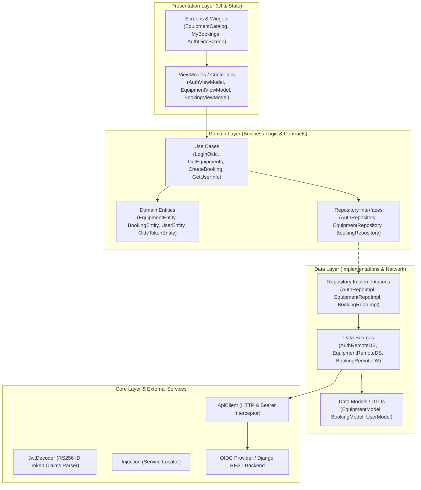

# ระบบจองอุปกรณ์ไอทีและนัดหมายเข้ารับ (IT Equipment Booking System)
**รายวิชา:** Mobile Application Development (Mobile Dev 2569) มหาวิทยาลัยอุบลราชธานี (UBU)  
**ผู้จัดทำ:** ณราธิป (`narathip-mobiledev69`)

---

## 📌 ภาพรวมโครงงาน (Project Overview)
ระบบจองอุปกรณ์ไอทีสำหรับการเรียนการสอน กิจกรรม และการทำงานวิจัย รองรับการเลือกดูอุปกรณ์ นัดหมายวันและเวลาเข้ารับอุปกรณ์ล่วงหน้า และติดตามสถานะการยืม-คืน ออกแบบตาม **สถาปัตยกรรมซอฟต์แวร์จริง (Clean Architecture + MVVM + Repository Pattern)** และเชื่อมต่อ **ระบบยืนยันตัวตนจริงผ่าน OpenID Connect (OIDC 1.0)**

---

## 🏗️ สถาปัตยกรรมซอฟต์แวร์จริง (Software Architecture)

โปรเจกต์นี้ได้รับการออกแบบตามหลักการ **Clean Architecture (Separation of Concerns)** แบ่งเลเยอร์อย่างชัดเจน ไม่ผูกติด UI เข้ากับ Network Logic โดยตรง:



### รายละเอียดของแต่ละเลเยอร์:
1. **Core Layer (`frontend/lib/core/`)**:
   - `network/api_client.dart`: ไคลเอนต์เครือข่ายส่วนกลาง ทำหน้าที่แนบ Header `Authorization: Bearer <token>` อัตโนมัติ จัดการ Timeout และ Error Handling
   - `utils/jwt_decoder.dart`: ตัวถอดรหัส JWT ID Token เพื่อตรวจสอบ Header (`alg: RS256`, `kid`), Payload Claims (`sub`, `iss`, `aud`, `exp`, `preferred_username`)
   - `constants/api_constants.dart`: จุดรวม Endpoints ทั้ง OIDC และ Business APIs
   - `errors/`: โครงสร้างข้อผิดพลาด `Failure` และ `Exception`
2. **Domain Layer (`frontend/lib/domain/`)**:
   - `entities/`: โมเดลบริสุทธิ์ของระบบ (Equipment, Booking, User, OidcToken)
   - `repositories/`: อินเทอร์เฟซนามธรรม (Abstract Contracts) เพื่อ decoupling เลเยอร์
   - `usecases/`: คำสั่งทางธุรกิจเฉพาะงาน (e.g. `LoginOidcUseCase`, `CreateBookingUseCase`, `GetUserInfoUseCase`)
3. **Data Layer (`frontend/lib/data/`)**:
   - `datasources/`: ติดต่อกับ REST API และ OIDC Provider
   - `models/`: Data Transfer Objects (DTOs) รองรับ JSON serialization/deserialization
   - `repositories/`: ตัวเชื่อมประสานระหว่าง Data Sources และ Domain
4. **Presentation Layer (`frontend/lib/presentation/`)**:
   - `viewmodels/`: จัดการสถานะแบบ Reactive (`ChangeNotifier`) แยกตรรกะออกจากหน้าจอ
   - `screens/` & `widgets/`: หน้าจอ Material 3 สวยงาม ทันสมัย รองรับ Responsive
5. **Dependency Injection (`frontend/lib/injection.dart`)**:
   - Service Locator คอยประกอบและสร้าง Instance ของทุกเลเยอร์ตั้งแต่ Data Source จนถึง ViewModel

---

## 🔐 ระบบยืนยันตัวตนจริงผ่าน OpenID Connect (OIDC 1.0)

ระบบหลังบ้าน (Backend) ทำหน้าที่เป็น **OpenID Connect Provider (IdP)** ตามมาตรฐานสากล:

1. **OIDC Discovery Endpoint:**  
   `GET /.well-known/openid-configuration` หรือ `GET /openid/.well-known/openid-configuration/`  
   ส่งกลับ Issuer, Authorize Endpoint, Token Endpoint, UserInfo Endpoint, JWKS Endpoint
2. **OIDC Authorize & Token Endpoints:**  
   - `GET /openid/authorize/` (Authorization Code Flow)
   - `POST /openid/token/` (แลกเปลี่ยน Code เป็น Tokens)
   - `POST /api/oidc/login/` (Direct OIDC Authentication สำหรับ Mobile UX)
3. **การเข้ารหัสและเซ็นดิจิทัล (RS256 JWT):**  
   - สร้างกุญแจคู่ **RSA Key (2048-bit)** สำหรับเซ็น ID Token
   - ออก **ID Token** ที่มี Signature ถูกต้องตามมาตรฐาน OpenID Connect 1.0
   - ออก **Access Token (Bearer)** และ **Refresh Token**
4. **OIDC UserInfo Endpoint:**  
   `GET /openid/userinfo/`  
   ตรวจสอบ Bearer Token และส่งคืน Claims ผู้ใช้ (`sub`, `name`, `preferred_username`, `email`, `roles`, `student_id`)
5. **ID Token Claims Inspector (ในหน้าแอปพลิเคชัน):**  
   - แสดง JWT Header (`alg`, `typ`, `kid`)
   - แสดง Payload Claims ตรวจสอบความถูกต้องของสิทธิ์และเวลาหมดอายุ (`exp`)
   - ปุ่มคัดลอก Access Token และ Raw ID Token ได้ทันที

---

## 👥 บัญชีผู้ใช้งานทดสอบ (Demo Accounts)

ระบบมาพร้อมกับบัญชีทดสอบที่พร้อมใช้งานทันที (คลิกเลือกได้จากหน้าจอ OIDC Login):

| Username | Password | ชื่อ - สกุล | บทบาท (Role) | อีเมล |
|---|---|---|---|---|
| `narathip` | `pass1234` | ณราธิป นันทสุรสีห์ | **นักศึกษา (Student)** | `narathip.n@ubu.ac.th` |
| `admin` | `admin1234` | Admin IT Service | **เจ้าหน้าที่ (Staff / Admin)** | `admin@ubu.ac.th` |
| `somchai` | `pass1234` | สมชาย ใจมั่น | **อาจารย์ (Staff)** | `somchai.j@ubu.ac.th` |

---

## 🚀 วิธีการติดตั้งและรันโปรเจกต์ (How to Run)

### 1. ฝั่งระบบหลังบ้าน (Backend - Django & OIDC Provider)
```bash
cd backend

# รัน Seed ข้อมูล OIDC (สร้าง RSA Key, Client และผู้ใช้ทดสอบ)
uv run manage.py seed_oidc

# รัน Seed ข้อมูลอุปกรณ์และคลังไอที
uv run manage.py seed_it_data

# รัน Server
uv run manage.py runserver 0.0.0.0:8000
```
* **API & OIDC Endpoints:**
  * `GET /.well-known/openid-configuration` : OIDC Discovery Metadata
  * `POST /api/oidc/login/` : ล็อกอินรับ OIDC Tokens (ID Token RS256, Access Token, Refresh Token)
  * `GET /openid/userinfo/` : ดูข้อมูล Profile ผู้ใช้งานจาก OIDC Access Token
  * `GET /openid/jwks/` : Public Key Set สำหรับตรวจสอบ Signature
  * `GET /api/equipments/` : ดูรายการอุปกรณ์ (รองรับ OIDC Bearer Token)
  * `GET /api/bookings/` : ดูรายการจองทั้งหมด (รองรับ OIDC Bearer Token)
  * `POST /api/bookings/` : สร้างรายการจองใหม่ (ตัดสต็อกอัตโนมัติ)
  * `PATCH /api/bookings/<id>/` : อัปเดตสถานะ (รับอุปกรณ์/คืนอุปกรณ์)
* **Admin Dashboard:** `http://127.0.0.1:8000/admin/`

### 2. ฝั่งแอปพลิเคชันมือถือ (Frontend - Flutter)
```bash
cd frontend

# ตรวจสอบ dependencies และรันแอป
flutter pub get
flutter run
```

---

## 🛠 เทคโนโลยีที่ใช้ (Tech Stack)
* **Backend:** Python 3, Django, Django REST Framework (DRF), `django-oidc-provider`, SimpleJWT, SQLite, `uv`
* **Frontend:** Flutter (Dart), Material 3, Clean Architecture, MVVM + Repository Pattern, HTTP Client, OIDC JWT Decoder
